# Glacier Modelling

## Session 1 — Lecture 1b: Mathematical and numerical modelling

Guillaume Jouvet

---

# Outline

- I> Mathematical modelling: ice flow + mass conservation
- II> Numerical modelling
- III> Applications to present-day and paleo glaciers
- IV> A cold case solved with a glacier model (the Ebener brothers)

---

# I> Mathematical modelling

---

# Glen's flow law

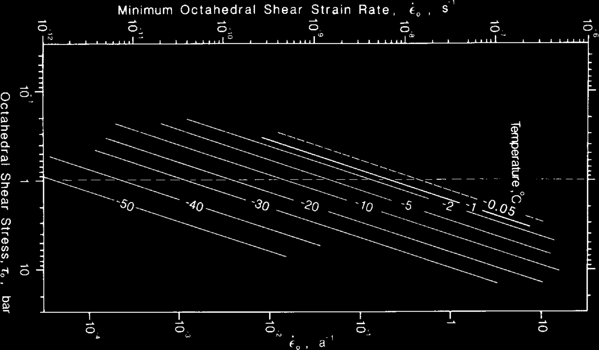

- 1D: $\dot\epsilon = A(T)\,\sigma^n$, where $\dot\epsilon$ is the strain rate, and $\sigma$ is the stress.

- 3D: $\dot\varepsilon_{ij} = A(T)\,[\sigma^{(d)}_{II}]^{n-1}\,\sigma^{(d)}_{ij}$ ➡️ Ice = non-Newtonian fluid <small>(J. Glen, 1958), n=3</small>

---

# Ice dynamics equations & boundary conditions

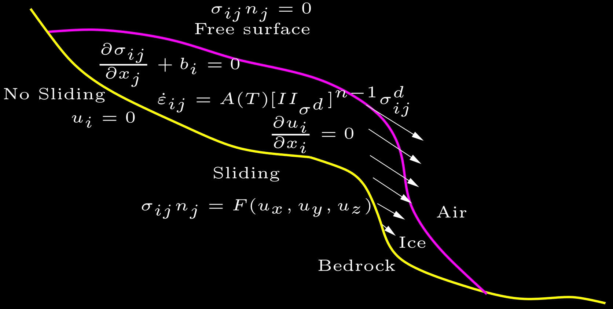

Note that the ice flow speed is independent of time!

---

# Shallow ice models (since glaciers are shallow)

| | |
|---|---|
| 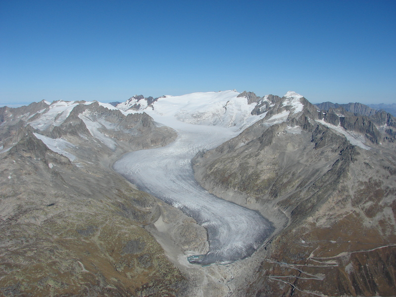 | 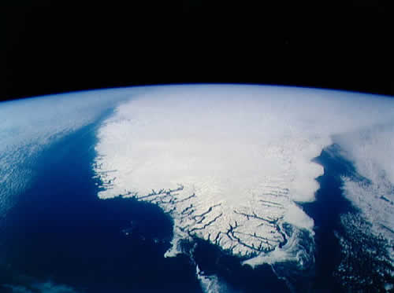 |
| *source: G. Kappenberger* | *source: NASA* |
| Mountain glacier | Ice sheet |
| aspect ratio $\sim 1/10$ | aspect ratio $\sim 1/1000$ |

---

# Shallow Ice Approximation (SIA)

Simplest ice flow model, velocity given by a formula ($n=3$):

$$
u(z) = \underbrace{\frac{-2A}{n+1}\left(\rho g \frac{\partial s}{\partial x}\right)^n
\left(H^{n+1}-(H-z)^{n+1}\right)}_{\text{deformation velocity}}
+ \underbrace{u_b}_{\text{sliding velocity}} \qquad (1)
$$

SIA is obtained by neglecting $\mathcal{O}(\epsilon^k)$,
where $\epsilon$ is the aspect ratio.

**Valid for**: thin ice, inland ice sheets, wide glaciers.
**Not valid for**: thick ice, ice domes, narrow glaciers, fast sliding.

---

# Shallow Ice Approximation (SIA)

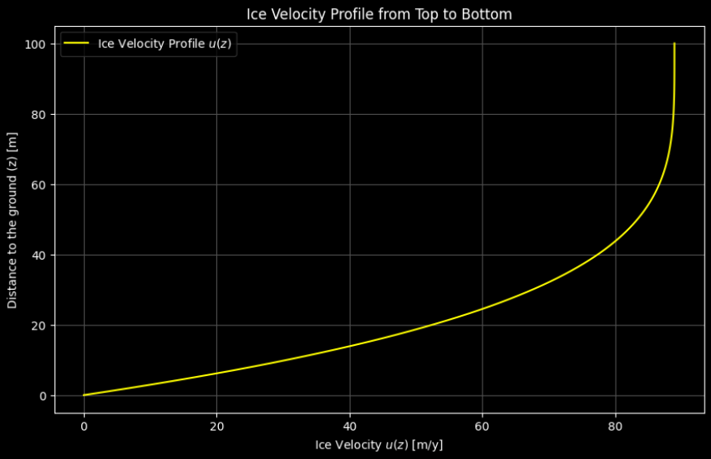

---

# Two (simplified) shallow ice models

- **SIA** (Shallow Ice Approximation) -> suitable for pure **shearing**
- **SSA** (Shallow Shelf Approximation) -> suitable for pure **sliding**

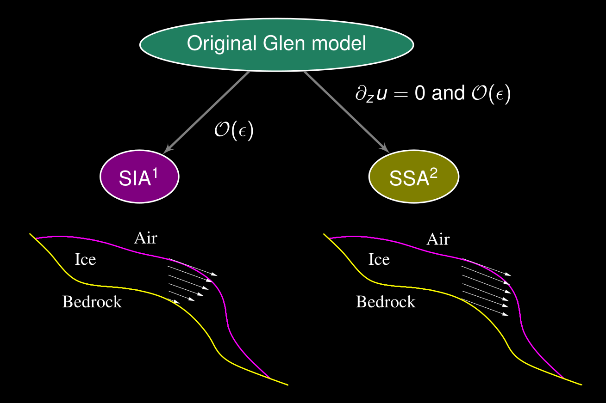

IGM solves a higher-order model (Blatter–Pattyn) that captures both.

---

# Dynamics of marine ice sheets

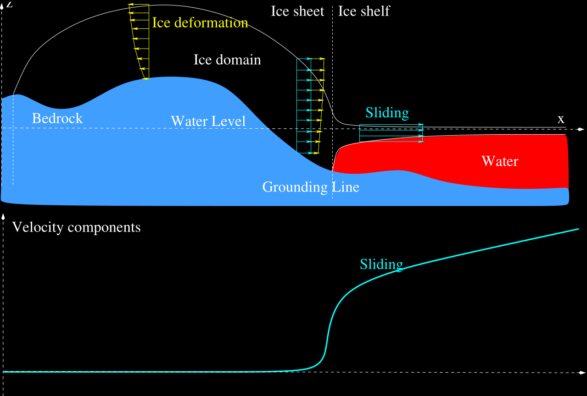

---

# Dynamics of the Antarctic Ice Sheet

*Ice flow field in Antarctica, the pink areas display where ice is fastest, over ice shelves (floating ice). See the [NASA website](https://svs.gsfc.nasa.gov/3849/) for animations.* Source: NASA.

---

# Connecting ice flow and mass conservation

Mass conservation: rate of change of thickness = surface mass balance (SMB) − flux divergence

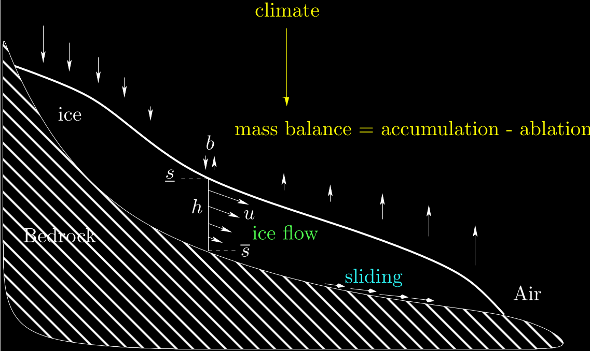

$$\frac{\partial h}{\partial t} + \frac{\partial}{\partial x} \left( \int_b^s u \, dz \right) = b \qquad (2) $$

---

# Glacier evolution equation

Combining SIA (1) with $n=3$ and no sliding with mass conservation (2) leads to a nonlinear diffusion equation (here in 1D) that predicts the evolution of the glacier geometry:

$$ \frac{\partial h}{\partial t} = \frac{\partial}{\partial x}\left(D(h)\frac{\partial z}{\partial x}\right) + b(z), \qquad (3) $$

where $D(h)$ is the ice diffusivity

$$ D(h) = \frac{2A}{5} (\rho g)^3 h^5 \left(\frac{\partial z}{\partial x}\right)^2 \qquad (4) $$

➡️ This is exactly what you will code/play with in **Tutorial 1**.

---

# II> Numerical modelling

---

# Need for a numerical glacier evolution model

The above equations are too complex to be solved analytically: we need a **numerical model** to approximate them.

- Link to the course on [numerical modelling](https://jouvetg.github.io/modnum/).

- 5 min video on glacier modelling: https://youtu.be/eJNIr_0zOyk

<figure style="text-align: center;">
    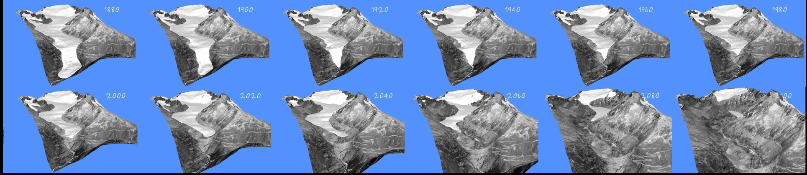
</figure>
 Numerically modelled retreat of Rhone Glacier from 1874 to 2100 (Jouvet et al., JCP, 2009)

---

# The glacier must be meshed/discretized ...

to solve the equations numerically.

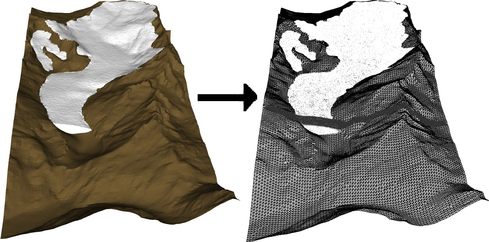

In practice, it is common to work with simplified (shallow) models.

---

# Transient glacier evolution computation

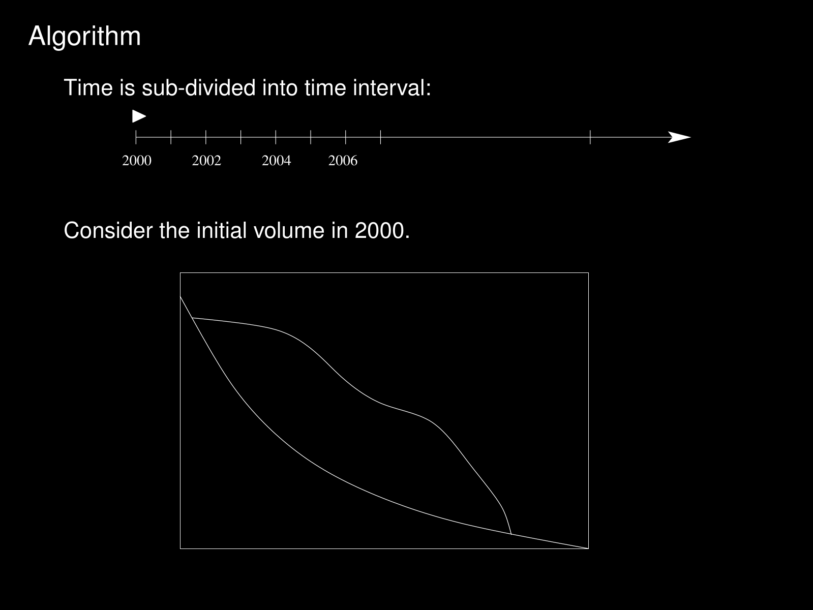

---

# Combining ice flow and mass balance models

The algorithm updates the glacier surface at each time step, accounting for both ice flow and surface mass balance

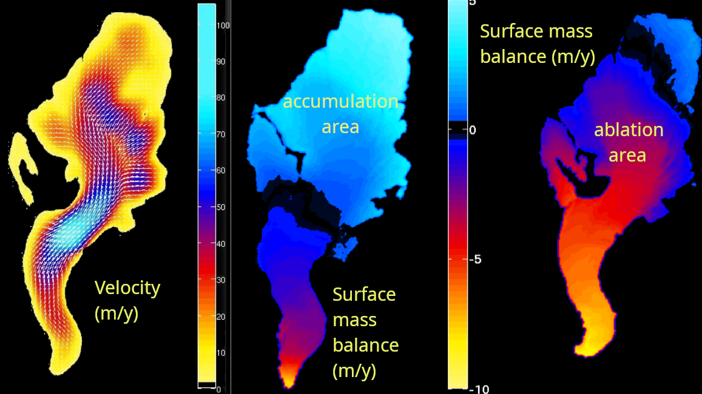

---

# Numerical models

- The SIA-based equations can be solved in a few lines of code (Tutorial 1), see also the course on [numerical modelling](https://jouvetg.github.io/modnum/) and the [Karthaus Summer School Lecture Notes](https://link.springer.com/book/10.1007/978-3-030-42584-5)

- Many open models developed by the glacier modelling community solve ice flow equations with different levels of complexity: [Elmer/Ice](https://elmerice.elmerfem.org/), [PISM](https://www.pism.io/), ISSM, CISM, [OGGM](https://oggm.org), IcePack, ...

- Here we will use the "Instructed Glacier Model" ([IGM](https://igm-model.org/), developed at UNIL), a Python-based glacier evolution model that uses Machine Learning (ML) and Graphics Processing Units (GPU) to accelerate computations ➡️ **Session 2**

---

# III> Present-day and paleo glacier applications

---

# Modelling the evolution of Aletsch Glacier

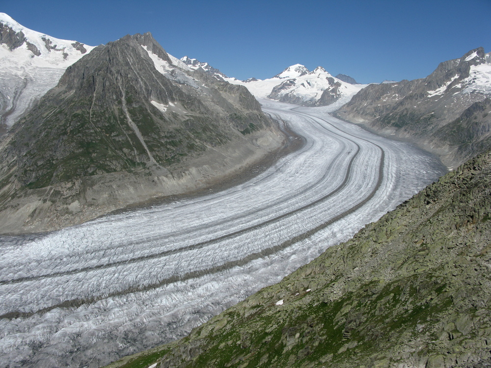

<small>Key numbers: ~ 20 km long – 80 km² – 13 km³ </small>

➡️ 1880–2010: Model validation <small>(Jouvet et al., JOG 2011)</small>
➡️ 2010–2100: Multiple climate scenarios <small>(Jouvet & Huss, JOG 2019)</small>

See the [simulation page](https://jouvetg.github.io/the-aletsch-glacier-module)

---

# Last Glacial Maximum in Switzerland

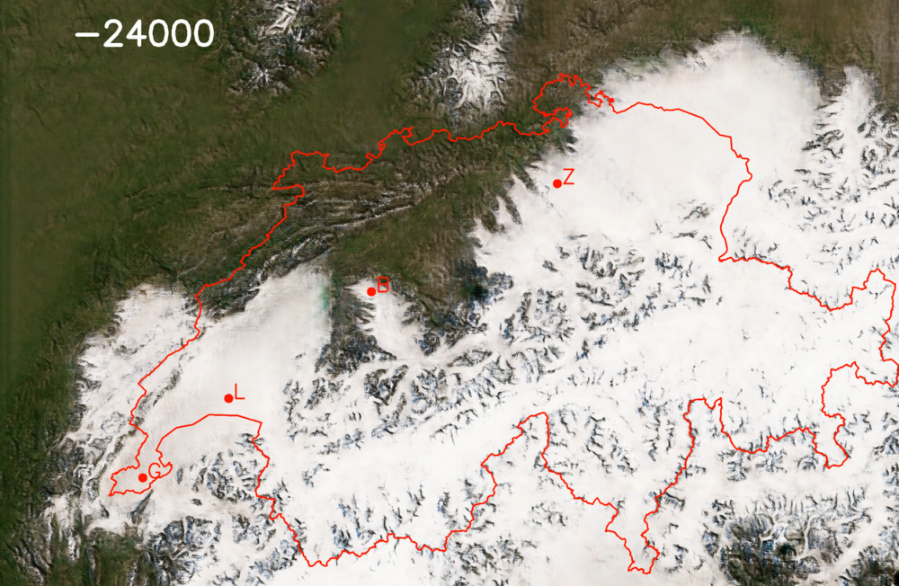

Can we reproduce this with a glacier model?

---

## Paleo glacier modelling in the Alps with IGM

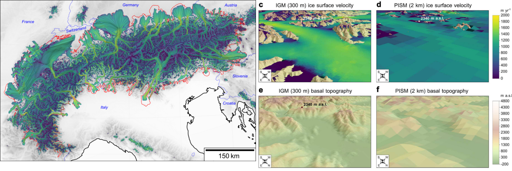

(Leger, Jouvet et al., Nature Com., 2025)

Modelling last ice age glacier evolution in the Alps: https://youtu.be/IbLOFh3U9gI

---

# Ice flow modelling for landscape evolution

... to model the alternation of ice flow-driven glacial (U) and fluvial (V) erosion.

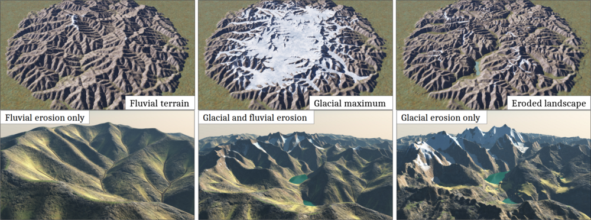

(Cordonnier, Jouvet et al., SIGGRAPH, 2023)

Simulation: https://youtu.be/xfk_J4VhdWA

---

# A cold case solved with a glacier model

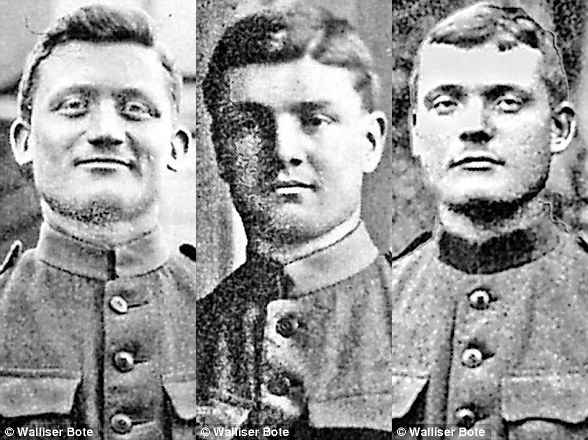

➡️ March 1926: the Ebener brothers vanish on the Great Aletsch Glacier
➡️ 2012: their remains are found near the tongue, ~10 km downstream

*Slides: [case-ebener.pdf](case-ebener.pdf) — short film: https://youtu.be/cyKb-P3mwDk*

---

# What did the model need?

- **Reconstruct the glacier** 1926 → 2012: geometry + ice flow, calibrated on observed surface elevations
- **Track particles** in the 3D ice flow: where must a body be buried in 1926 to emerge where it was found in 2012?
- Compare the possible scenarios (crevasse fall, avalanche, exhaustion) with the burial depth/location implied by the model

➡️ Same ingredients as your mini-project: **data + SMB + ice flow + calibration**, plus a **question**.
➡️ In IGM: `particles` module (see igm-examples `aletsch`, Part A, Step 4).

---

# Next: Tutorial 1 (1 hour)

Open the Renku session, then `session1/tutorial-1-sia-model.ipynb`:

1. Velocity profile of the SIA
2. A 1D glacier: steady state, sensitivity to ELA, SMB gradient, ice softness
3. Response time: glacier under an oscillating climate
4. A 3D glacier: Gorner Glacier, find the ELA that fits today's extent

Then (last hour): **choose your glacier** for the mini-project → `session1/choose-your-glacier.md`
