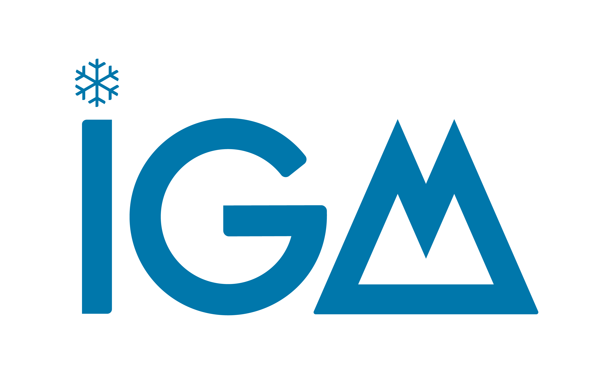
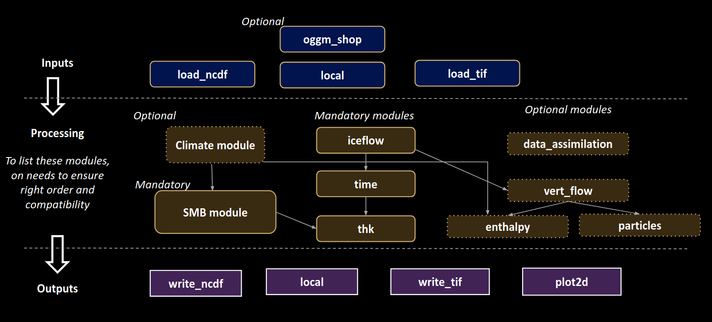
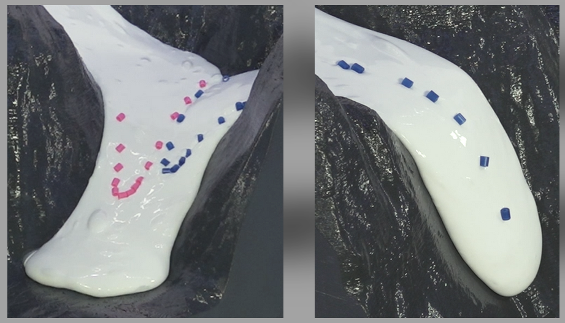

# Glacier Modelling

## Session 2 — Lecture 2: Introduction to IGM

Guillaume Jouvet



---

# Today (Session 2)

| | |
|---|---|
| Hour 1 | Lecture 2: the Instructed Glacier Model (IGM) — introduction to RenkuLab — first IGM runs (Tutorial 2) |
| Hours 2–4 | Mini-project: set up and run **your** glacier (with the assistant) |
| Break | Glacier goo: ice flow in the lab |

---|---|
| Hour 1 | Lecture: the Instructed Glacier Model (IGM) |
| Hour 2 | Tutorial 2: first IGM runs (`session2/tutorial-2/tutorial-2-igm.ipynb`) |
| Hours 3–4 | Mini-project: set up and run **your** glacier |

---

# From Tutorial 1 to IGM

Tutorial 1: 1D/2D SIA model, synthetic SMB, no sliding, 50 lines of numpy.

A "real" glacier model needs:
- **real data**: topography, ice thickness, outlines, velocities, climate
- a **better ice-flow model** than SIA (steep, narrow valleys; sliding)
- a **better SMB model** (driven by temperature and precipitation)
- **efficiency**: many runs (calibration, scenarios), on a laptop or in the cloud

➡️ IGM: an open-source Python model developed at UNIL — https://igm-model.org

---

# What does IGM solve?

Same structure as Tutorial 1, at each time step:

1. **Surface mass balance**: $b(x,y,t)$ from an ELA or from climate
2. **Ice flow**: 3D velocity field from a higher-order (Blatter–Pattyn) Stokes approximation, with Glen's law and basal sliding
3. **Mass conservation**: $\dfrac{\partial h}{\partial t} + \nabla\cdot(\bar{\mathbf{u}}\,h) = b$
4. Update time, write outputs, repeat

---

# Where is the machine learning?

Step 2 (ice flow) is the costly part. IGM solves it with a **neural network** (a CNN):

- input: thickness, surface, ice softness, basal friction, ...
- output: the ice velocity field
- trained to **minimize the energy** of the ice-flow problem ("physics-informed": no data needed)

Two modes:
- **off-line emulator**: network pre-trained on many glaciers, frozen → very fast, for "standard" mountain glaciers ← *we use this*
- **on-line solver**: network (re)trained during the run → general, slower

➡️ Runs fast on CPU, much faster on GPU.

---

# IGM is modular



**inputs** (load data) → **processes** (run at each time step) → **outputs** (write results)

All modules share one object: the **state** (`state.thk`, `state.usurf`, `state.smb`, `state.t`, ...)

---

# A parameter file (`experiment/params.yaml`)

```yaml
defaults:
  - common: iceflow_offline       # pre-trained ice-flow emulator
  - override /inputs: [local]     # 1) which data
  - override /processes: [smb, iceflow, time, thk]   # 2) which physics, in order
  - override /outputs: [local, live_dashboard]       # 3) which outputs

processes:                        # parameters that differ from the defaults
  smb:
    method: simple
    simple:
      array:
        - ["time", "gradabl", "gradacc", "ela", "accmax"]
        - [1900,    0.009,     0.005,     2800,  2.0]
        - [2000,    0.009,     0.005,     2900,  2.0]
  time: {start: 1900.0, end: 2000.0, save: 10.0}
```

Run it: `igm_run +experiment=params`

---

# Changing parameters

- Edit the YAML file (keep a copy per experiment!), or
- override from the command line, without editing the file:

```bash
igm_run +experiment=params processes.time.end=2050
igm_run +experiment=params inputs.oggm_shop.RGI_ID="RGI2000-v7.0-G-11-01189"
```

- Results go to `outputs/<date>/<time>/`, with a copy of the full configuration (`.hydra/config.yaml`): every run is **reproducible**.
- All parameters and their defaults: https://igm-model.org (Modules)

---

# Data for any glacier: `oggm_shop`

Give an RGI v7 ID; IGM downloads (via [OGGM](https://oggm.org)) and maps to a 100 m grid:

- surface topography (Copernicus DEM)
- ice thickness estimate (Millan et al. 2022, or consensus)
- glacier outline (RGI v7)
- observed surface velocities (Millan et al. 2022)
- monthly climate 1901–present (GSWP3-W5E5)
- calibrated SMB parameters (to match Hugonnet et al. 2021 geodetic mass balance)

Everything ends up in `data/input.nc`, cached for the next runs.

---

# Two ways to force the SMB

**1. `smb: method: simple`** — ELA + gradients, prescribed in time
- few, intuitive parameters; no climate needed
- good to explore sensitivity and to reconstruct the LIA

**2. `climate: method: oggm` + `smb: method: oggm`** — temperature-index model
- monthly temperature & precipitation → accumulation and melt
- 1901–2019: observed climate; **outside** this period: random years of 1960–1990 + a **trend** (temperature offset, precipitation factor, relative to 1960–1990):

```yaml
clim_trend_array:
  - ["time", "delta_temp", "prec_scal"]
  - [ 2020,     1.3,     1.0]     # ≈ today (2000-2019 vs 1960-1990)
  - [ 2100,     4.0,     1.0]     # +4°C vs 1960-1990
```
- `melt_enhancer`: scales melt (uncertain melt factors)

---

# Ice-flow parameters

- **Ice softness** $A$ (`arrhenius`, default 78 MPa⁻³ a⁻¹): softer ice → faster deformation
- **Basal sliding**: Weertman-type law, parametrized by
  - `tau_ref`: basal shear stress (MPa) needed to slide at
  - `u_ref` (100 m/yr)
  - lower `tau_ref` → more slippery bed → faster sliding

Usually tuned so that modelled surface speeds match **observed** ones (provided in `input.nc`).

---

# What you get

- `output.nc`: maps through time (thickness, surface, speed, SMB, ...) ➡️ maps, flowline profiles
- `output_ts.nc`: ice volume and area through time ➡️ time series
- `dashboard_XXXX.png`: quick-look images during the run

Helpers in `utils/helper.py`: `animate_glacier_evolution`, `analyze_time_series`, `plot_flowline_evolution`, `compare_modeled_observed_velocity`

---

# The modelling workflow for your project

1. **Present**: download data, check the initial state (thickness, velocities vs. observations)
2. **Past**: start before the LIA (e.g. 1700) from today's geometry, cool then warm the climate, to reproduce the **LIA maximum (~1850)** and the **retreat to today** ➡️ calibration / validation
3. **Future**: 2020–2100 under several warming scenarios (e.g. SSP1-2.6, SSP2-4.5, SSP5-8.5)

Glaciers respond with a delay: mind the **response time**.

---

# Introduction to RenkuLab

**Where do we run IGM?** On [renkulab.io](https://renkulab.io), a platform of the Swiss Data Science Center (EPFL/ETH)

- JupyterLab **in your browser** — nothing to install on your laptop
- IGM 3.2 and all Python packages are **pre-installed** in the course environment
- Runs on Swiss servers, with a resource pool (with **GPUs**) reserved for this course
- Login with your **SWITCH edu-ID** (UNIL account)

---

# RenkuLab: the vocabulary

| Renku | What it is for you |
|---|---|
| **Project** | Your copy of the course: material (code repository) + launcher + storage |
| **Session launcher** | The "Launch" button: starts a machine with IGM + JupyterLab |
| **Session** | Your running machine (CPU, RAM, disk) — temporary! |
| **Data connector** | Your SWITCHdrive folder, mounted in the session: **where you save your work** |

---

# Step 1 — Your own copy of the course (once)

1. Go to **renkulab.io** → *Log in* with SWITCH edu-ID
2. Open the course project (link on Moodle)
3. Click the banner button to **copy the project** → this is now *your* project
4. *(Recommended)* In your project: add a **data connector** → *SWITCHdrive* → choose a folder (e.g. `glamod-work`)
5. *Settings* → *Members*: add the teacher and the assistant as **viewers**

---

# Step 2 — Launch a session (each time)

1. Open **your** project → *Sessions* → **Launch** (`glamod` launcher)
2. Wait 1–3 min → JupyterLab opens in your browser
3. File browser (left): `glamod/` = course material, plus your SWITCHdrive folder
4. Open a notebook, e.g. `glamod/session2/tutorial-2/tutorial-2-igm.ipynb`

At the end of the afternoon: **Pause** the session (do not delete it).

---

# Step 3 — Run IGM

In a notebook cell (with `!`), from the folder that contains `experiment/`:

```bash
!igm_run +experiment=params_A_aletsch
```

or in a JupyterLab **Terminal** (*File → New → Terminal*):

```bash
cd ~/work/glamod/session2/tutorial-2
igm_run +experiment=params_A_aletsch
```

Results: `outputs/<date>/<time>/` — plot them with the helpers in the notebooks.

---

# Step 4 — Save your work ⚠️

A session is a **temporary machine**: it may be deleted after a period of inactivity.

- Copy what matters to your **SWITCHdrive folder** (drag & drop in the file browser, or `cp -r`):
  - your notebook(s), your `experiment/*.yaml` files, your figures
- `output.nc` files can be large: keep only the useful ones — they can be re-created by re-running IGM
- Or right-click → *Download* to your laptop

**Rule**: never finish an afternoon without saving your YAML files and notebook.

---

# When something goes wrong

| Symptom | Fix |
|---|---|
| Session does not start | Wait (all GPUs may be busy), retry, or launch with the CPU resource class; check you launched from **your** project |
| `igm_run: command not found` | Wrong launcher/environment → use the `glamod` launcher |
| Kernel dies / very slow | Out of memory: restart kernel; shorter run; close other notebooks |
| Data download (`oggm_shop`) fails | Retry — the server may be busy when 20 students download at once |
| Lost files | Were they in the SWITCHdrive folder? |

Ask the assistant!

---

# Tutorial 2 (now)

`session2/tutorial-2/tutorial-2-igm.ipynb`

- **Run A**: Aletsch, 1900–2000, simple ELA-based SMB (local data)
- **Run B**: any glacier from its RGI ID, climate-driven SMB, 2020–2100, +4°C → **try it with your glacier!**
- **Run C** (optional): write your own SMB module in Python

---

# Break: glacier goo

Ice flow in the lab with a viscous "goo": 9 short films (UZH, 3G).

➡️ Slides `session2/glacier-goo.md`


